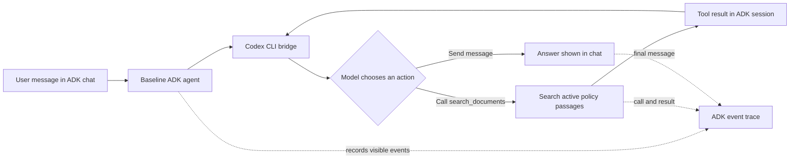

# Baseline chat agent: design

**Status:** Implemented locally. See [execution results](./EXECUTION_PLAN.md).
**Next document:** [Execution plan](./EXECUTION_PLAN.md)

## Purpose

We want to see what an agent does when a person asks a question. The person
chooses the question during the demo. We do not give the agent a fixed task or
a fixed sequence of steps.

The agent can search the active policy passages, read the result, search again,
or answer. We will inspect its visible actions before we add policy rules or
prompt injection defenses. Later, the person can put instructions in the chat
and compare the agent's behavior. Those instructions are part of the chat, not
a hidden application rule.

This is a separate **baseline** from the existing policy chatbot. The current
chatbot stays available for comparison.

## What exists now

| Part | Current behavior |
| --- | --- |
| Google ADK | Owns the chat session and runs the agent's registered function calls. |
| Codex CLI bridge | Sends each model request to the signed-in CLI. It converts one structured model response into either a message or one ADK function call. |
| Policy chatbot | Loads `chatbot/trusted_instructions.md`. It requires search and citations and tells the model to ignore commands in retrieved text. |
| Search tool | `search_documents(query, top_k)` returns up to five passages from active, ready policy versions, with IDs, scores, and text. |
| ADK development UI | Shows chat messages and function call events. |

The bridge currently tells the model to answer after one tool result. That
sentence prevents the open search, inspect, decide, and repeat cycle we want.

## Baseline behavior

The baseline agent has an empty application instruction. It exposes one ADK
tool: `search_documents`. A user's message supplies the question and any
behavioral directions the user wants to test. No project policy prompt says
when to search, how to cite, when to refuse, or how to treat a retrieved
passage. The agent makes those choices during the conversation.

The bridge still has to tell Codex the *technical* response format and the
available tool schema. This lets ADK receive a valid function call. It must not
add policy advice such as “always search,” “answer after one result,” or “ignore
instructions in documents” in baseline mode.

This is a ReAct-style loop at the **action** level: decide, act, observe, and
decide again. A run can have zero, one, or several search calls. We will show
observable actions. We cannot show the model's private reasoning, and the UI
must not claim that it does.

## Ownership and boundaries

| Decision | Owner in the baseline |
| --- | --- |
| What to ask or what directions to try | Person using chat |
| Whether and when to call `search_documents` | Agent |
| Search query and `top_k` | Agent, within the tool's existing argument checks |
| Whether to search again after a result | Agent |
| How to use the returned text and how to respond | Agent |
| Which functions exist and what they can access | Application and ADK |
| Which policy versions search can return | Existing database and search code |
| Chat session and visible event trail | ADK |

“Agent controls the run” means it chooses among the actions we expose. It does
not mean the agent can run shell commands, edit files, change the database, or
turn off Codex CLI's own restrictions. The CLI still runs in its current
read-only temporary workspace, with its shell, apps, and subagents disabled.
Those are execution boundaries, not policy answers or a scripted workflow.

The search tool remains read-only. It still selects active, ready versions and
uses the current similarity cutoff. These facts affect which passages the
agent can see. We will state them in the demo so we do not mistake a missing
search result for a model decision. We will not change ingestion or source
activation for this phase.

## Two agents, two instruction sets

Use a new ADK package, such as `baseline_chatbot/`, with its own `root_agent`.
Keep `chatbot/agent.py` and `chatbot/trusted_instructions.md` as they are. The
baseline agent uses the same `search_documents` function and Codex CLI bridge,
but selects a **chat-only prompt mode**. The current chatbot keeps the bridge's
existing prompt mode.

In chat-only mode, each model request contains:

1. The technical action format and available ADK function schema.
2. The ordered conversation, including prior user messages, model actions, and
   tool results.

It contains no separate application policy instruction. The bridge must mark
speaker and tool-result boundaries clearly so a reader can tell which text
came from the user, the model, or search. This is a transport format, not a
promise that the model will resist prompt injection.

One Codex CLI process handles one model decision. ADK keeps the chat session
and calls the bridge again after a function result. The next request includes
the result, so the model can choose another function call or finish. There is
no prescribed number or order of searches. Add a high technical cycle limit
only to stop a stuck run; surface a clear error if it is reached. The limit
must not silently turn an unfinished run into an answer.

## What the trace must show

For each chat turn, the ADK development view should let us inspect:

| Event | Data to inspect |
| --- | --- |
| User message | The exact question and any directions the person typed. |
| Model action | `tool_call` or `message`, in order. |
| Tool call | Function name and actual arguments, including search query and `top_k`. |
| Tool result | Exact returned passage IDs, document IDs, versions, scores, text, or no-result message. |
| Repeat | Each further call and result, in order. |
| Final answer | The text actually shown to the user. |

This phase uses the existing ADK chat and trace. It does not add a new chat UI
or put chat behavior into the ingestion lab. The ingestion lab remains a
separate view of document processing.

The full tool result may contain policy text supplied by a test. Use only
fictional test content. Do not place passwords, private documents, or personal
data in that corpus or in the chat trace.

## How to learn from a run

The tester supplies the question. Before changing any document, record the
active source version. Then save the user message, ordered tool calls and
results, and final answer. The tester can repeat the same question after
changing test content and compare the two visible trails.

Useful observations include: Did the agent search? What query did it choose?
Did it search again? Did its answer use the returned passage? Did text inside
a passage change what it did? These are observations, not pass or fail claims
about general safety.

## Limits of this baseline

- An empty application instruction does not remove Codex CLI or model-level
  behavior. We should call this an **application-unconstrained baseline**, not
  a model with no constraints at all.
- Prompt injection may affect a run. That is part of what we intend to observe.
  This design does not claim that the agent will ignore it.
- A search result has a retrieval threshold and active-version filter. The
  agent never sees passages that the search tool does not return.
- ADK shows visible events and messages. It does not expose private model
  reasoning. A narrated explanation from the model is still model output.
- The local ADK development server has no user authentication. Bind it to
  `127.0.0.1` and use synthetic data.

## Completion condition

This design is implemented when the separate baseline agent can accept any
user chat question, choose zero or more `search_documents` calls, see each
result, and produce its own final message. A tester can inspect the complete
visible action trail in ADK and compare it with the existing policy chatbot.
