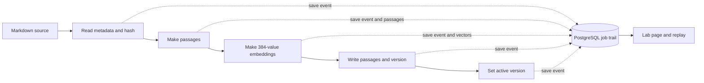
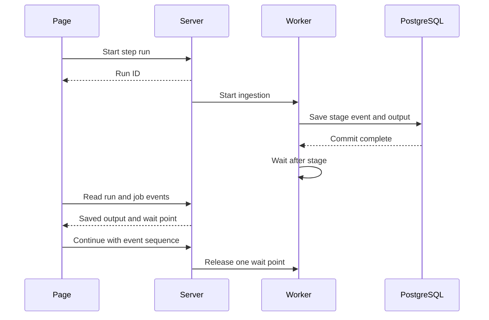

# RAG ingestion lab: design

**Status:** Implemented locally. See [the execution plan](./EXECUTION_PLAN.md) for checked validation and limits.

## Why build this page?

A policy update can change the answer that a customer receives. We need to see
how the new policy moves from a Markdown file into the search database. This
page will show each real result. It will also show when the new version becomes
active.

The lab covers ingestion only. The existing ADK chat page and agent trace stay
separate.

This document uses short sentences, active verbs, and one term for each idea.
These choices draw on [ASD-STE100 guidance](https://www.asd-ste100.org/STE_faq.html).
This document has not been checked against the full ASD-STE100 specification.

## The five things a reader should learn

1. A source file has an ID, a version, and a hash.
2. The splitter makes passages from the source text.
3. The embedding model turns each passage into 384 numbers.
4. PostgreSQL stores the passages and their embeddings.
5. A new version becomes active only after the full database write succeeds.

## Terms

| Term | Meaning in this lab |
| --- | --- |
| Source | A Markdown policy file in `data/policies/`. |
| Document | The policy identity, such as `RETURNS`. |
| Version | One fixed revision of a document, such as `RETURNS v2`. |
| Passage | A piece of the source text that the search tool can return. The code calls this operation `split_passages`. |
| Embedding | A list of 384 numbers made from one passage by the local model. One number has no useful name by itself. |
| Job | One attempt to ingest a version. A retry is a new job. |
| Event | A saved point in a job, with a time and details. |
| Active version | The version that the search tool reads now. |
| Replay | A view of saved job data. Replay does not run ingestion again. |

## What exists now

The project already has source parsing, passage splitting, local embeddings,
PostgreSQL writes, and job events. It uses Python, `psycopg`, FastEmbed, and
PostgreSQL 18. The model is `BAAI/bge-small-en-v1.5`.

The current `RETURNS v2` file makes one passage. An unchanged v2 file exits as
already ready. It does not create a new job. A full new run needs a new version.

The lab will use one new synthetic `RETURNS v3` file with enough text for at
least four passages. Prepare the file before the first demo. Leave it
un-ingested until the user starts that demo. The v3 file should keep the
policy clear and self-consistent. Do not change v1 or v2. Ingesting v3 will
change the active `RETURNS` version for the existing search tool.

## One page, three modes

| Mode | What happens | What the user controls |
| --- | --- | --- |
| Live | The worker runs every stage without a planned pause. The page reads saved events. | Start a new version and watch. |
| Step | The worker saves one stage result and waits. | Click **Continue** to start the next stage. |
| Replay | The page reads a past job and its saved artifacts. | Move between events in either direction. |

The page can refresh during a step run. The worker and its wait signal stay in
the server process. The page keeps the temporary run ID in the URL and asks
the server for the current run state again.

The first build supports one active lab run at a time. A second start request
gets a clear `409` response. A double click on **Continue** must advance only
one stage. The request includes the event sequence that the user can see.

## The real data path

The same ingestion function serves the CLI and the lab. The lab supplies a
callback that controls the wait. The CLI supplies its current print callback.
The lab does not reimplement validation, splitting, embedding, or indexing.

## What each stage shows

| Saved state | Work that has finished when the page shows it | Page content |
| --- | --- | --- |
| `PENDING` | The database has created the job. The parser has already checked the source. | Job ID, file path, document ID, version. |
| `VALIDATING` | The parser has checked metadata and made the source hash. | Exact source snapshot, parsed fields, SHA-256. |
| `CHUNKING` | The splitter has made the passages. | Passage IDs, full text, character counts, and boundaries. |
| `EMBEDDING` | The local model has returned valid vectors. | Model name, 384 values per passage, duration, and a similarity view. |
| `INDEXING` | The data is ready for the final database transaction. | Planned passage IDs, row count, old active version. The write has not happened yet. |
| `READY` | The database has committed all passages and the new active pointer. | Stored row count, new active version, commit time. |
| `FAILED` | The attempt stopped. | Safe error, last complete stage, and the version that stayed active. |

The state names in the current code do not all mean “work is underway.” The
page must use the completed-work descriptions above. In particular, the
`INDEXING` event occurs before the database write.
The parser must read the file before it can create a version row. Thus,
`PENDING` and `VALIDATING` appear after the source check. The page must not
animate a new parse between these two saved events.

In step mode, the callback waits after `VALIDATING`, `CHUNKING`, `EMBEDDING`,
and `INDEXING`. `PENDING` records job creation; it is not a work stage. The
callback does not wait after `READY` or `FAILED`.
The event and its artifacts must commit before the callback waits. Do not hold
a database transaction open while the user decides to continue.

## A source and its passages

The source panel shows the exact Markdown text that the parser read. It shows
the parsed ID, title, version, and SHA-256. The hash identifies that source
snapshot. If the file changes later, replay still shows the original snapshot.

The passage panel shows each output of the existing `split_passages` function.
It shows the text and character count. It also shows the configured 650
character limit and 80 character overlap. An overlap applies when a long
paragraph must be split. The page must not draw an overlap where none exists.
Add passage position metadata to the splitter for this view. Keep the current
`split_passages` return value for existing callers and tests.

The final passage ID has the form `RETURNS-v3-p1`. The page can show this
planned ID before the write. After `READY`, it can show the matching row in
`policy_passages`.

## How to show an embedding

The page uses the real vector returned by FastEmbed. It shows the first 16
values at first. The user can expand the full list of 384 values. A heatmap
uses those same values. A label states that each cell is one vector value.

A second view shows a cosine similarity matrix for all passages in that job.
The matrix uses the stored vectors. It helps a reader see which passages are
close in the model space. Similarity is a computed comparison. It is not a
fact about policy meaning or correctness.

If we add a 2D plot later, label it as a projection. Do not present the two
plot coordinates as the model's output. Do not use invented vector values or
simulated model progress.

## Database tables

The lab reuses the existing tables. One small migration adds the data that
replay needs.

| Table | Purpose in the lab |
| --- | --- |
| `policy_documents` | Stores the document identity and title. |
| `document_versions` | Stores each version, source path, hash, and status. |
| `ingestion_jobs` | Stores one attempt, its current status, and its safe error. |
| `ingestion_job_events` | Stores the ordered timeline. A new `payload JSONB` column stores the real output at each point. |
| `policy_passages` | Stores ready passages and their 384-value vectors. |
| `active_document_versions` | Selects the version that search reads. |
| `schema_migrations` | Records applied schema migrations. |

Add `run_mode TEXT NOT NULL DEFAULT 'CLI'` to `ingestion_jobs`. Limit lab values
to `LIVE` and `STEP`. The default preserves old CLI jobs. The lab can identify
its unfinished jobs after a server restart.

Add `payload JSONB NOT NULL DEFAULT '{}'::jsonb` to `ingestion_job_events`.
The payload contains only data that the stage produced. Examples follow:

| Event | Payload fields |
| --- | --- |
| `VALIDATING` | Source snapshot, ID, title, version, hash, byte count. |
| `CHUNKING` | Passage index, planned ID, text, character count, split settings. |
| `EMBEDDING` | Model name, dimension count, duration, and full vector for each passage. |
| `INDEXING` | Planned IDs, row count, old active version. |
| `READY` | Committed IDs, row count, old and new active versions. |
| `FAILED` | Safe error category and last complete state. |

For this small synthetic corpus, a JSONB snapshot is simple to inspect in
DBeaver. It duplicates a small amount of text and vector data. A future large
corpus would need a different artifact store. Set a clear file-size limit for
lab starts. Keep the existing CLI behavior for other files.

Write each event and its payload in one database transaction. Write passages,
`READY`, and the active-version update in one transaction. This rule prevents
the page from showing a committed activation before its passages exist.

Extend the migration runner to apply numbered SQL files in order. The current
runner knows only `001_initial_schema.sql`. The new file should be
`002_ingestion_lab.sql`. It must add columns without deleting existing data.

## The pause mechanism

The web request returns at once. A worker thread runs ingestion. A local
`threading.Event` holds the worker after a saved milestone in step mode. The
server keeps the run ID, job ID, mode, and current wait point in memory.

The page polls the server about every half second. It reads events from
PostgreSQL. A Continue request names the current event sequence. The server
releases the worker only if that sequence is still the wait point. This check
prevents two clicks from skipping a stage.

The callback should stop waiting when the server shuts down. Mark an unfinished
lab job as failed with a safe interruption message. On the next start, repair
only stale lab jobs. Keep past events for replay. Do not change unrelated CLI
jobs. A new attempt may ingest the same source hash after an interruption.
The page also has a **Stop run** button. It stops at the next stage boundary
and records `FAILED` with a clear “Stopped by user” detail.

Use a PostgreSQL advisory lock for one document during ingestion. Both CLI and
lab runs use this lock. A paused worker can keep the lock without keeping a
database transaction open. A second attempt for that document gets a clear
busy error. Release the lock when the job ends or fails.

An invalid source can fail before `ingestion_jobs` gets a row. The start API
must show that validation error and leave the database unchanged. The first
build does not need a replay record for this preflight error.

## Local API and page

The lab runs on `127.0.0.1:8002`. It does not call Google ADK or Codex.
It uses a small FastAPI app and one HTML/CSS/JavaScript page. Add FastAPI and
Uvicorn as direct locked dependencies if this design is approved for build.

| Request | Result |
| --- | --- |
| `GET /api/sources` | List Markdown files under `data/policies/` and their current readiness. |
| `POST /api/runs` | Start one selected file with `LIVE` or `STEP`; return a temporary run ID. |
| `GET /api/runs/{run_id}` | Return the active control state, job ID when known, and wait point. |
| `POST /api/runs/{run_id}/continue` | Release one wait point. Require the expected event sequence. |
| `POST /api/runs/{run_id}/stop` | Stop at the next stage boundary and record the result. |
| `GET /api/jobs` | List saved lab jobs and their status. |
| `GET /api/jobs/{job_id}` | Return ordered events and payloads for live display or replay. |

The API accepts a selected relative file path from the allowed policy folder.
The source parser still enforces its path rules. The server binds only to
loopback. It shows no database connection string, password, or local auth file.

The page has three parts: a job list, a stage timeline, and a detail panel.
The detail panel changes with the selected stage. It uses text, tables, and
simple charts made from the returned numbers. It must label live, paused, and
replay states clearly. It must show recorded times; it must not invent a
progress percentage for the embedding model. The current state must stand
out in the stage row. Stages that have not started must stay visible but quiet.
When a reader moves through replay, the selected stage becomes the current
view and later saved stages appear as incoming. The page has a small floating
moon/sun control. It saves the user's light or dark choice with the Cimulink
website's `cimulink-theme` preference.

## Failure and retry example

The user starts `RETURNS v3` in step mode. The page stops after embeddings.
It shows the vectors and the current active version, v2. After Continue, the
page stops before the database write. The user sees that v2 is still active.
One more Continue commits the passages and sets v3 active.

If embedding or indexing fails, the job becomes `FAILED`. The active pointer
stays on v2. The user can inspect the saved stage data and start a new attempt
with the same source. The retry gets a new job ID.

## Scope limit

This is a local teaching and test page for a small synthetic corpus. It has
one server process and one active lab run. It does not add a durable queue,
multiple workers, uploads, user accounts, or a chat trace. A server restart
does not resume a paused Python call; it closes that attempt and permits a
retry.

## Sources

- [Current ingestion code](../../rag/ingestion.py)
- [Current schema](../../migrations/001_initial_schema.sql)
- [Current source parser and splitter](../../rag/documents.py)
- [Current embedding wrapper](../../rag/embeddings.py)
- [ASD-STE100 overview](https://www.asd-ste100.org/STE_faq.html)
- [FastAPI background task guidance](https://fastapi.tiangolo.com/tutorial/background-tasks/)
