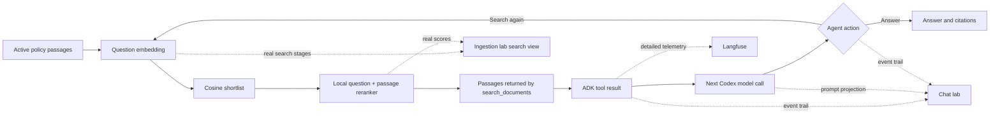

# Retrieval and chat lab: design

**Status:** Design for the next local build. See [execution plan](./EXECUTION_PLAN.md).

## The two questions this lab answers

1. **Which policy passages reach the agent, and why?** Show quick vector search, a local reranker, and the final passages side by side.
2. **What happens during a chat turn?** Show each visible agent decision, tool input, tool output, model input, and model output in order.

The ingestion lab already shows how a file becomes passages and embeddings. The new search view belongs beside that teaching flow. Reranking happens **after ingestion**, when a user asks a question. It does not change stored embeddings or rewrite a policy.

The chat view is a separate local page. Langfuse keeps its detailed technical trace. This page gives a reader a clear account of the same real run. It does not show private model reasoning.

## Current system and boundaries

- `rag/search.py` embeds a question with `BAAI/bge-small-en-v1.5`, compares it with stored 384-value vectors, filters at cosine `0.72`, and returns at most five passages from active, ready versions.
- `rag/lab_api.py` and `rag/lab_web/` serve the ingestion page on `127.0.0.1:8002`. The saved ingestion events are in PostgreSQL.
- `baseline_chatbot` uses Google ADK, the signed-in Codex CLI, and one read-only `search_documents` tool. The policy chatbot uses the same tool with trusted instructions.
- `chatbot/codex_model.py` rebuilds each Codex prompt from ADK conversation contents. Earlier tool results can therefore appear again in a later model call. The first build must show this honestly; context pruning is a separate measured change.
- `chatbot/tracing.py` enables Langfuse when the ignored `.env` has its three settings. The local visual layer must not depend on remote Langfuse availability.

The project database is the isolated `rag_document_update` database at `127.0.0.1:55433`. The local pages bind to `127.0.0.1`. Keep credentials and connection strings out of event payloads and browser responses.

## Reader path



The diagram shows the run path. It does not imply that the agent always searches or cites. The baseline agent can answer without calling its tool.

## Local reranker

Use FlashRank's CPU ONNX cross encoder, `ms-marco-MiniLM-L-12-v2`. The model is small enough for a local demonstration and downloads to an ignored project cache on first use. Pin a tested package version in `pyproject.toml` and `uv.lock`. Do not require an API key, Docker, GPU, or a new database service. The installed FastEmbed 0.9.0 provides our embeddings but does not expose `TextCrossEncoder`, so use a separate reranker package.

Search in two stages:

1. Embed the question and compute cosine scores for **active, ready** passages exactly as today. Take a bounded candidate set for reranking. Do not discard candidates using the current `0.72` final-result cutoff *before* reranking; that would stop the second stage from recovering a low-cosine answer. Record the candidate limit and ordering. In this small corpus, use up to 20 candidates.
2. For each candidate, score the **question and passage together** with the local reranker. Sort by rerank score; return up to `top_k` (still capped at five). Keep passage ID, document ID, version, and text. Include both scores and both ranks in the structured search result. A rerank score is for ordering this question's candidates; do not display it as a probability or compare its scale with cosine.

The reranker may reorder passages. It cannot verify that a policy is true or that an answer is supported. If the model download or inference fails, report a clear error to the lab and search caller; do not label a cosine-only result as reranked. Cache the model across calls. Avoid re-embedding passages at chat time.

The chat tool and the lab must call one shared retrieval function. A lab-only copy would misrepresent the agent's actual search. Keep the existing `search_documents(query, top_k)` name and ADK-visible signature. Put the detailed candidate trail behind a separate internal function or optional internal result so the tool output remains bounded. The lab can request that detail without putting every candidate into the LLM context. Label any score and ranking policy changes in the UI and README.

## Ingestion lab search view

Add a **Try a question** area to the existing page. This is a read-only search experiment. It is available when at least one version is active and ready. Choosing an un-ingested source does not make it searchable. State which active versions were searched. An ingestion replay still shows the saved ingestion snapshot; a new question searches today's active corpus and must be labeled **current search**, not replayed ingestion data.

Show one horizontal journey:

| Stage | Reader sees | Important distinction |
| --- | --- | --- |
| Question | Exact typed question | This is the input to the embedding model. |
| Quick search | Candidate passage IDs, short excerpts, cosine scores and first ranks | Cosine measures broad vector similarity. |
| Rerank | The same candidates reordered, rerank scores and new ranks | The model reads each question/passage pair. Scores use a different scale. |
| Sent to agent | Exact passages and total text size returned by `search_documents` | Only these become this tool result's context. |

Draw rank movement with restrained connecting lines. An unchanged rank is still visible. Let the reader select a passage to see the full text and its two scores. Do not imply that the highest score is a proven answer. Empty results, model download, and model errors need plain messages. Keep the ingestion timeline separate from this search journey.

## Chat lab: one honest event trail

Serve a branded local page on a separate port, `127.0.0.1:8003`. Use the existing ADK agents and runner; do not build a second agent policy or a second search implementation. The page can start a chat session, send a question, and step through **recorded** events after or while they arrive. This is playback of an actual run, not a control that pauses Codex between model calls.

For each turn, show an ordered lane of visible steps:

| Step | Input to show | Output to show |
| --- | --- | --- |
| User message | User's exact question | ADK turn starts. |
| Model call | Readable summary of actual prompt: trusted instruction presence, prior messages, tool results, available tool, and character or token estimate | Agent message or one requested tool call. |
| Tool call | Tool name and exact query/top_k arguments | Search begins. |
| Search | Cosine candidates, rerank movement, selected passages | Returned tool JSON, passage IDs, version, text size. |
| Model call after tool | Actual prompt projection, including which prior results remain in it | Next tool call or final answer. |
| Answer | Evidence available to the model | Exact final text and cited passage IDs, if any. |
| Error | Last completed step | Safe error and stop state. |

Use ADK events for tool calls, tool responses, and answers. Capture the **actual prompt built by `CodexCliModel`** at the model boundary; deriving it from UI guesses would hide context growth. Do not record or display Codex private reasoning. Do not claim an agent 'selected' a passage unless the tool returned it or the answer cited it. Show 'returned to agent' and 'cited in answer' as separate states.

Keep a compact default view. Each step shows one sentence, its main input, its main output, and elapsed time if measured. Expand a step to inspect the exact query, full returned passage text, or a readable prompt. The context strip shows per-call character count, message count, tool-result count, and which prior results are still included. Label character count as **characters**, not tokens, unless measured with the model tokenizer.

Save each local chat run and its ordered public events in PostgreSQL so the page can replay after refresh or server restart. Keep the current ADK in-memory conversation session for live chat; a saved run is replayable evidence, not a resumable ADK session after restart. Use a numbered additive migration. Do not store keys, environment variables, CLI command arguments, or private reasoning. The UI can show a Langfuse trace link only if a verified trace ID is available; do not invent one from the local run ID.

## Visual direction

Use the existing Cimulink wordmark, symbol, tokens, and light/dark theme behavior. The visual anchor is a **single continuous run line**. Each real event advances a point on that line. The selected point opens a two-column **Input → Output** reading surface. Current and completed points carry stronger contrast; future points remain quiet. A search step opens a rank-movement inset that matches the ingestion lab.

Use typography, spacing, rules, and restrained slate accents from the current ingestion lab. Avoid a wall of cards, unexplained JSON, and animated decorative motion. Use clear action labels, keyboard focus, narrow-screen layouts, and reduced-motion support. Put the technical Langfuse link in a secondary position.

## Local event contract

The browser needs stable JSON from the local server. Use IDs and sequence numbers rather than parsing display text:

```json
{
  "run_id": "uuid",
  "turn_index": 1,
  "sequence": 4,
  "kind": "tool_result",
  "status": "complete",
  "occurred_at": "ISO timestamp",
  "duration_ms": 18.2,
  "input": {"tool": "search_documents", "query": "return window", "top_k": 5},
  "output": {"passage_ids": ["RETURNS-v3-p1"], "result_count": 1},
  "detail": {"result": "exact bounded tool response"}
}
```

The example shows the shape, not a fabricated run. Store the real outputs. `kind` should distinguish user, model input, model decision, tool call, search stages, tool result, answer, and error. `run_id` groups one conversation run; turn and sequence preserve order. A model-input event reports what the bridge actually sent. Existing Langfuse tracing remains separate and may contain more detail.

## What to verify

Use known local policy questions: direct answer, condition plus exception, unrelated question, and two searches in one turn. Compare cosine order, rerank order, returned passages, final answer, and prompt size at each call. Record cases where reranking helps or hurts; do not claim it improves accuracy from one example. Verify source/version filtering, DB isolation, no credential leakage, local replay, and a real Codex-backed chat view. Inspect the page in a browser at desktop and narrow width, in light and dark themes. Verify Langfuse separately with an actual trace when credentials and network access permit it.

## References

- [FlashRank project and local CPU usage](https://github.com/PrithivirajDamodaran/FlashRank)
- [BGE explanation of cross encoder reranking](https://huggingface.co/BAAI/bge-reranker-base)
